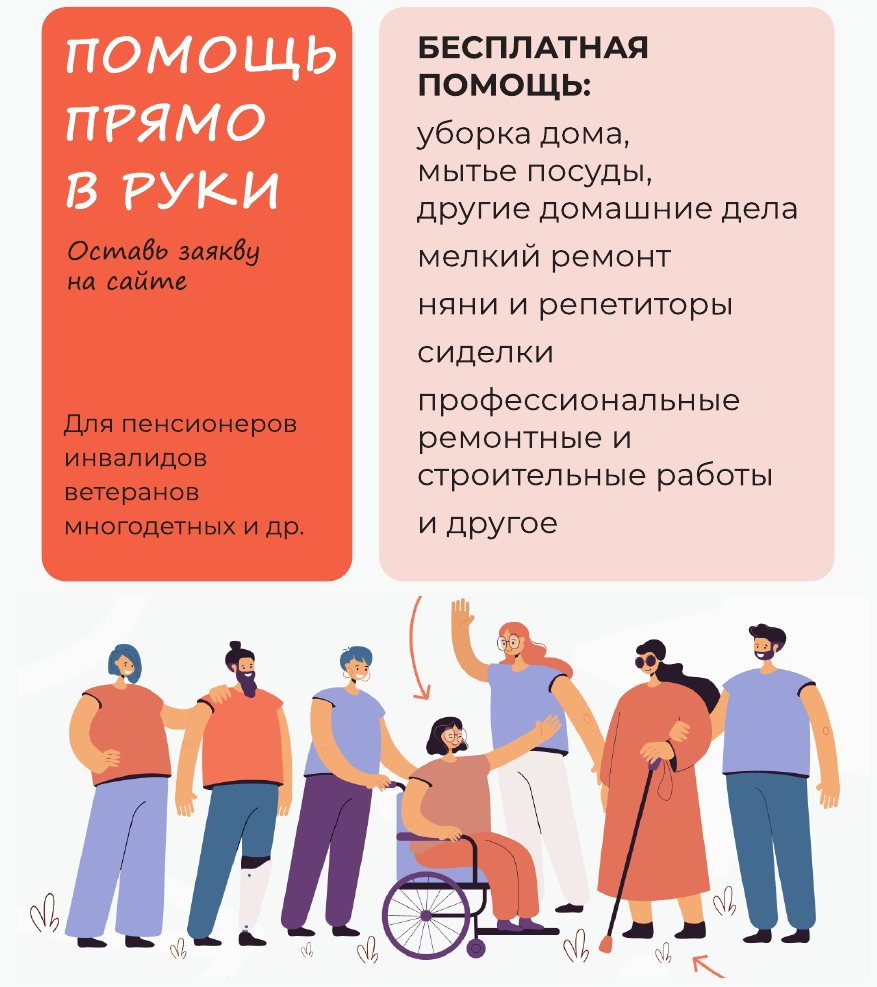
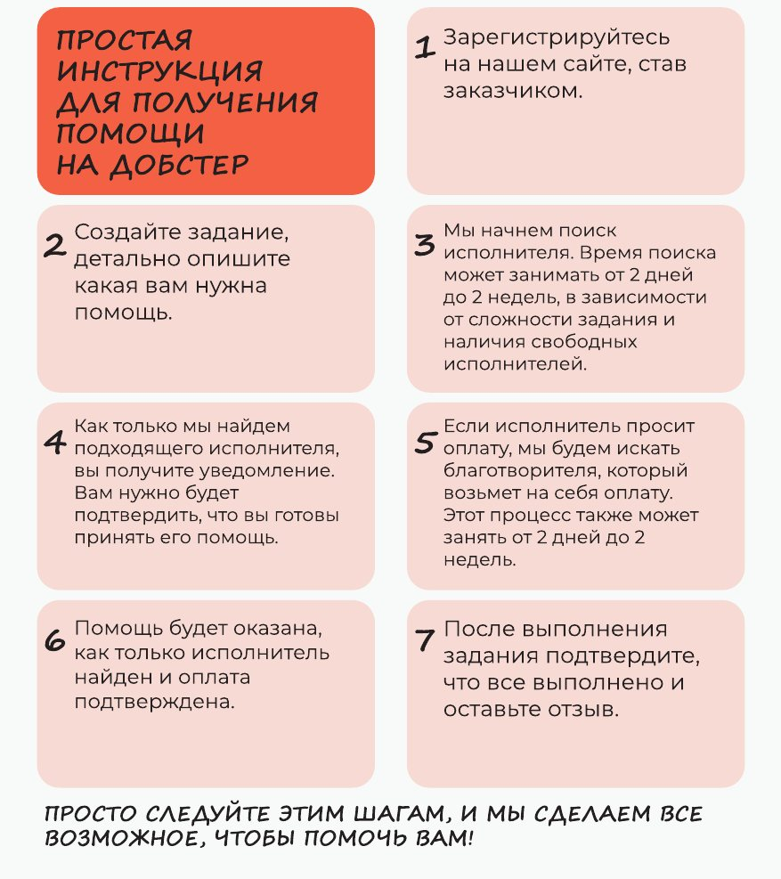

# «Добстер»: платформа благотворительных услуг

**Менеджер продукта и сооснователь** · «Добстер» · ноябрь 2022 — октябрь 2023 (дополнительный проект)

| | |
|---|---|
| **Продукт** | платформа, где пожилые люди, люди с инвалидностью, ветераны и многодетные семьи бесплатно получают помощь по дому и услуги специалистов, web + adaptive (B2C) |
| **Стадия** | запуск с нуля до продакшена |
| **Стек** | Python, React |
| **Сайт** | dobster.ru |

## Идея: «Помощь прямо в руки»

Человек, которому нужна помощь, оставляет заявку на сайте — и получает её бесплатно: уборку и домашние дела, мелкий ремонт, няню или репетитора, сиделку, профессиональные ремонтные и строительные работы.

Платформа соединяет три стороны:

- **заказчика** — того, кому нужна помощь;
- **исполнителя** — волонтёра или специалиста, который её оказывает;
- **благотворителя** — того, кто оплачивает работу, если исполнитель работает не бесплатно.

## Как это работает

1. Получатель подтверждает свой статус через Госуслуги и оставляет задание на платформе.
2. Платформа оповещает помощников, они откликаются, получатель выбирает исполнителя.
3. Платформа оповещает благотворителей, один из них подтверждает финансирование задания.
4. Помощник выполняет задание и отправляет отчёт благотворителю.
5. Благотворитель принимает работу и подтверждает оплату.

«Добстер» — некоммерческий проект: платформа не берёт комиссий, деньги благотворителя идут напрямую на задание. Потенциальная аудитория — 69 млн человек, которые в России официально относятся к социально уязвимым группам.

## Путь заказчика

1. Регистрация на сайте в роли заказчика.
2. Создание задания с подробным описанием помощи.
3. Поиск исполнителя — от 2 дней до 2 недель, в зависимости от сложности и свободных исполнителей.
4. Уведомление о найденном исполнителе и подтверждение, что заказчик готов принять помощь.
5. Если исполнитель просит оплату — поиск благотворителя, который возьмёт её на себя (тоже от 2 дней до 2 недель).
6. Помощь оказывается, как только исполнитель найден и оплата подтверждена.
7. Заказчик подтверждает выполнение и оставляет отзыв.

<figure><figcaption>Листовка для заказчиков: что можно получить</figcaption></figure><figure><figcaption>Листовка для заказчиков: семь шагов к помощи</figcaption></figure>

## Партнёрская программа

Чтобы привлекать благотворителей и помощников, мы сделали программу для компаний — «Говорите о добре, дарите добро, творите добро»:

- **рассказать** о «Добстере» клиентам и сотрудникам;
- **подарить** призы и привилегии самым активным помощникам и благотворителям;
- **профинансировать** задачи или участвовать как волонтёры.

Взамен компания получает партнёрский блок на платформе, совместную PR-кампанию для прессы, рассылок и соцсетей и выход своих подарков на аудиторию проекта.

📎 [Презентация партнёрской программы, PDF](https://astro090-pm.github.io/assets/decks/dobster-partnership.pdf)

## Что я сделал

- Создал концепцию продукта и роадмап.
- Спроектировал модель с тремя ролями и путь заказчика — так, чтобы им мог пройти пожилой человек: подтверждение статуса через Госуслуги, заявка, подтверждение, отзыв.
- Придумал партнёрскую программу для компаний как канал привлечения благотворителей и помощников.
- Разработал мокапы.
- Собрал команду.
- Запустил продукт в продакшен.

## Что этот кейс показывает

Полный цикл запуска продукта в социальной сфере, где пользователь — не самая цифровая аудитория, а сделку закрывают сразу три стороны: тот, кому нужна помощь, тот, кто помогает, и тот, кто платит.
